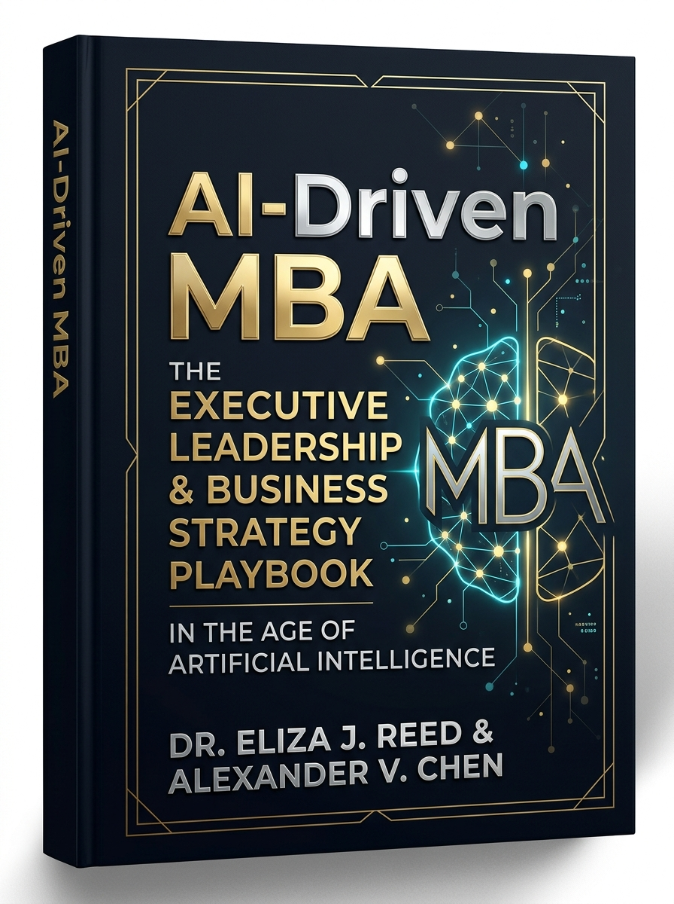

# 🎓 AI Çağında MBA (AI-Driven MBA)
### *Sıfırdan Zirveye: Yapay Zeka ile Güçlendirilmiş Yönetici ve Strateji Rehberi*
### *The Executive Leadership & Business Strategy Playbook in the Age of Artificial Intelligence*



> **Yazarlar / Authors:** Dr. Eliza J. Reed & Alexander V. Chen  
> **Sürüm / Edition:** 2026-2027 Executive Master Edition  
> **Format:** 40 Ayrı Parça (PDF & Markdown) + 1 Birleşik Ana Kitap (Master PDF & Markdown) | Türkçe & İngilizce  
> **Hedef:** Google NotebookLM ile Podcast / Sesli Özet & Udemy Video Eğitimi  

---

## 📌 Proje Genel Bakış (Project Overview)
Geleneksel 2 yıllık MBA programları yüz binlerce dolar harcatıp 1980'lerden kalma tozlu vaka analizlerini ezberletirken; **AI-Driven MBA**, ilk işe başladığınız analistlik gününden milyar dolarlık otonom şirketler yöneten bir CEO / Kurucu olmaya kadar uzanan 40 adımlık modern bir iş zekası mimarisi sunar.

Bu eser; **eğlenceli, basit, analojilerle dolu (ELI5)** anlatımıyla hem sıfırdan başlayanlar hem de şirketini yapay zeka ile dönüştürmek isteyen kıdemli yöneticiler için tasarlanmıştır.

Her ders şu standart pedagojik formatta hazırlanmıştır:
1. **📌 Kısa Özet & Zihniyet Dönüşümü (Executive Summary & Mindset Shift)**
2. **💡 Aptala Anlatır Gibi (ELI5) & Eğlenceli Hikaye (Intuitive Metaphor)**
3. **⚖️ Eski Usul vs. AI Destekli Yaklaşım (Comparison Matrix)**
4. **🚀 Adım Adım Eylem Çerçevesi (Actionable Framework)**
5. **🚨 Gerçek Hayat Vaka / Kriz Analizi (War Story & Case Study)**
6. **🤖 Kullanıma Hazır AI Promptları & Şablonlar (Battle-Tested Prompts)**
7. **🎙️ NotebookLM Podcast Tartışma Komutu (Deep Dive 2-Speaker Script)**
8. **🎓 Udemy Ders Özeti, Video Zaman Damgaları & Egzersiz (Lecture Blueprint)**

---

## 🏛️ 8 Ana Bölüm & 40 Derslik Müfredat (Curriculum)

| Bölüm # | Seviye & Tema | Kapsanan Dersler | Odak Konuları |
|---|---|---|---|
| **Bölüm 1** | **Temeller & Bireysel Verimlilik Çarpanı** *(Junior & Associate)* | Ders 01 - 05 | Ezberleri yıkmak, veri analitiği, Minto piramidiyle yönetici iknası, pazar radarı ve halüsinasyon savunması. |
| **Bölüm 2** | **Ürün Yönetimi, İnovasyon & Değer Yaratma** *(Product Lead)* | Ders 06 - 10 | Jobs-to-be-Done, sentetik personalar, 48 saatlik MVP prototipleme, dinamik fiyatlandırma ve ürün-pazar uyumu (PMF). |
| **Bölüm 3** | **Büyüme, Pazarlama & Müşteri Deneyimi** *(Growth Director)* | Ders 11 - 15 | 4E pazarlama karması, Multi-Armed Bandit büyüme korsanlığı, LTV/CAC birim ekonomi cerrahlığı, otonom destek ajanları ve kriz iletişimi. |
| **Bölüm 4** | **Operasyonlar, Tedarik Zinciri & Yalın Süreçler** *(Operations Director)* | Ders 16 - 20 | Süreç madenciliği ile TIMWOODS israfını yok etme, akıllı tedarik zinciri, Agentic Workflows, sıfır hata SLA ve ESG yeşil operasyonlar. |
| **Bölüm 5** | **Finansal Yönetim, Değerleme & Sermaye Tahsisi** *(VP Finance & CFO)* | Ders 21 - 25 | Finansal tabloların röntgeni (DuPont), DCF & Monte Carlo değerlemesi, 13 haftalık nakit akışı savunması, CapEx/OpEx ROI hesabı ve türev araçlarla korunma (Hedging). |
| **Bölüm 6** | **İnsan Kaynakları, Liderlik & Kültür** *(Chief People Officer)* | Ders 26 - 30 | Beceri odaklı kör işe alım, asenkron uzaktan çalışma kültürü, psikolojik güvenlik, dinamik OKR mimarisi, tersine mentorluk ve John Kotter değişim yönetimi. |
| **Bölüm 7** | **Kurumsal Strateji, M&A & Dijital Dönüşüm** *(Chief Strategy Officer)* | Ders 31 - 35 | Hamilton Helmer 7 Powers ekonomik hendekler, AI destekli M&A due diligence, iki taraflı pazar yerleri, şirket içi Skunkworks ve EU AI Act regülasyon uyumu. |
| **Bölüm 8** | **C-Suite Liderliği, Girişimcilik & Geleceğin Vizyonu** *(CEO & Visionary)* | Ders 36 - 40 | CEO ajandası ve yönetim kurulu yönetimi, VC pitch deck & Term Sheet müzakeresi, algoritmik etik yönetişim, 1 kişilik milyar dolarlık unicorn modeli ve büyük final manifestosu. |

---

## 🎙️ Google NotebookLM ile Udemy & Podcast Üretimi Rehberi

Bu müfredat Google NotebookLM için özel olarak optimize edilmiştir:
1. [NotebookLM](https://notebooklm.google.com/) platformunu açın ve yeni bir çalışma alanı (Notebook) oluşturun.
2. `books/tr/individual-pdfs/` veya `content/tr/` klasöründeki dersleri kaynak (Source) olarak yükleyin.
3. Her dersin içinde yer alan **🎙️ NotebookLM Podcast Tartışma Komutu**'nu kopyalayın.
4. **NotebookLM -> Studio -> Audio Overview (Deep Dive)** bölümüne bu komutu yapıştırıp üretin.
5. İki uzman sunucunun samimi, esprili ve derinlikli diyaloglarından oluşan **40 bölümlük eksiksiz bir executive podcast serisi** elde edeceksiniz!

---

## 🎓 Udemy Eğitimi Olarak Yayınlama Adımları

Her dersin altında yer alan **🎓 Udemy Ders Özeti, Video Zaman Damgaları & Egzersiz** bölümü şu akışı sağlar:
- **00:00 - 05:00**: Kanca (Hook), problemin tanımlanması ve zihniyet dönüşümü.
- **05:00 - 15:00**: Çekirdek metodoloji, eski usul vs. AI karşılaştırması.
- **15:00 - 20:00**: Canlı ekran paylaşımı, AI prompt uygulaması ve vaka analizi.
- **20:00+**: Haftalık eylem görevi, quiz ve ödev.

---

## 📂 Dosya ve Dizin Yapısı

```
mba/
├── assets/
│   └── cover.jpg                         # Kitap Kapak Görseli
├── books/
│   ├── tr/
│   │   ├── AI_Driven_MBA_Master_TR.pdf   # 40 Derslik Birleşik Türkçe Ana Kitap (PDF)
│   │   ├── AI_Driven_MBA_Master_TR.md    # Birleşik Türkçe Markdown Kitap
│   │   ├── AI_Driven_MBA_Master_TR.html  # Baskıya Hazır Türkçe HTML
│   │   └── individual-pdfs/              # 40 Ayrı Dersin Türkçe PDF'leri (Ders_01 ... Ders_40)
│   └── en/
│       ├── AI_Driven_MBA_Master_EN.pdf   # 40-Lesson Combined English Master Book (PDF)
│       ├── AI_Driven_MBA_Master_EN.md    # Combined English Markdown Book
│       ├── AI_Driven_MBA_Master_EN.html  # Print-Ready English HTML
│       └── individual-pdfs/              # 40 Individual Lesson PDFs in English (Lesson_01 ... Lesson_40)
├── content/
│   ├── tr/                               # 40 Parça Türkçe Markdown Dosyaları (part-01 ... part-08)
│   └── en/                               # 40 Modular English Markdown Files (part-01 ... part-08)
├── scripts/
│   ├── modules_data_01_02.py             # Bölüm 1 & 2 Veri Seti (Ders 1 - 10)
│   ├── modules_data_03_04.py             # Bölüm 3 & 4 Veri Seti (Ders 11 - 20)
│   ├── modules_data_05_06.py             # Bölüm 5 & 6 Veri Seti (Ders 21 - 30)
│   ├── modules_data_07_08.py             # Bölüm 7 & 8 Veri Seti (Ders 31 - 40)
│   └── generator.py                      # Master PDF, Markdown, HTML ve Web Derleyici
├── web/
│   ├── index.html                        # İnteraktif Yönetici Portalı (Web Arayüzü)
│   ├── styles.css                        # Lüks Obsidian & Gold Tasarım Sistemi
│   ├── app.js                            # Çok Dilli Arama, Filtreleme ve İndirme Motoru
│   └── data.js                           # Web Portalı JSON Veri Deposu
└── README.md                             # Kapsamlı Proje Rehberi
```

---

## 🌐 İnteraktif Portalı Yerel Olarak Başlatma

Web arayüzünü tarayıcınızda açmak ve tüm PDF'leri tek tıkla indirmek için:

```bash
cd /Users/aliturgutbozkurt/Desktop/mba
python3 -m http.server 4585
```

Ardından tarayıcınızdan `http://localhost:4585/web/index.html` adresine gidin.
Portaldan hem Türkçe hem İngilizce içerikleri okuyabilir, hazır promptları kopyalayabilir, NotebookLM komutlarını alabilir ve hem tekil ders PDF'lerini hem de birleşik ana kitap PDF'lerini indirebilirsiniz.

---
© 2026-2027 AI-Driven MBA Curriculum. Tüm Hakları Saklıdır.
